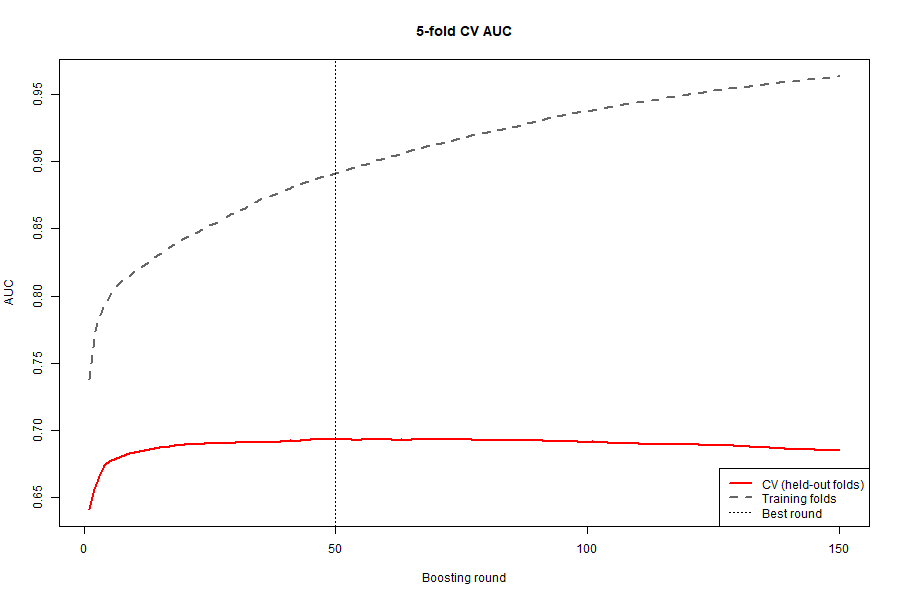
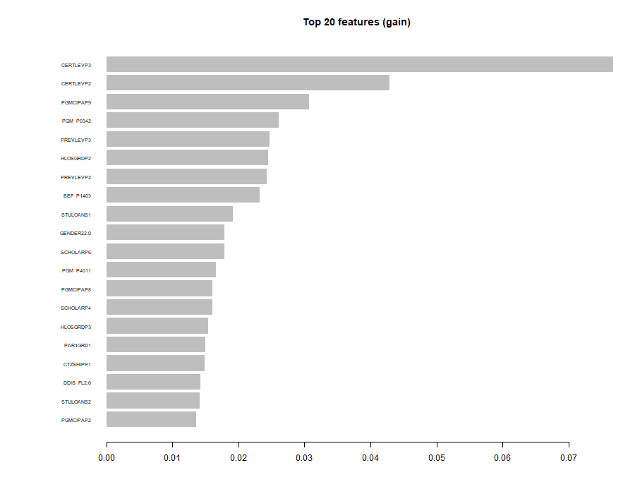

# Graduate Underemployment Prediction Challenge

This project tackles a **binary classification problem**: predicting whether Canadian post-secondary graduates are **underemployed (overqualified)** for their current jobs using survey data from the **National Graduates Survey (NGS 2020)**.

The work was completed as part of a machine-learning challenge and focuses on **robust modeling, careful evaluation, and generalization**, rather than optimizing for training accuracy alone.

---

## 📌 Problem Overview

Underemployment occurs when a graduate’s educational credential exceeds the qualification required for their job. This project predicts underemployment using demographic, educational, and background variables collected three years after graduation.

**Target variable**
- `overqualified = 1` → graduate is overqualified  
- `overqualified = 0` → appropriately matched or underqualified  

**Evaluation metric**
- **ROC AUC** (Area Under the Receiver Operating Characteristic Curve)

---

## 📊 Dataset

Files provided:
- `train.csv` – training data with target label  
- `test.csv` – test data (no labels)  
- `sample_submission.csv` – submission format  

The data files are not included in this repo: they come from the National Graduates Survey (NGS 2020) via the challenge, and I haven't confirmed the licence allows redistribution. Put `train.csv` and `test.csv` in the repo folder to run the scripts.

Key characteristics:
- Survey-encoded categorical variables  
- Missing values present  
- Class imbalance  
- High-cardinality categorical features (e.g. field of study)

---

## 🧠 Modeling Approach

### 1. Data Preprocessing
- Converted all predictors to **categorical factors**
- Explicitly encoded missing values as a `"Missing"` level
- Dropped identifier column (`id`)
- One-hot encoded features using sparse matrices

### 2. Baseline Model
- **Random Forest (R)** used as an initial benchmark
- Evaluated using **out-of-bag (OOB) ROC AUC**
- Revealed limited generalization performance (~0.68 AUC)

### 3. Final Model: XGBoost
- Switched to **XGBoost** for improved performance on tabular data
- Used **5-fold cross-validation** (`xgb.cv`)
- Optimized:
  - `max_depth`
  - `eta` (learning rate)
  - `min_child_weight`
  - `subsample`, `colsample_bytree`
  - `scale_pos_weight` (class imbalance)
  - `lambda` (L2 regularization)

Early stopping was applied to prevent overfitting.

### 4. Logistic Regression comparison
- `LogisticRegression.qmd`: same preprocessing, plain logistic regression on all predictors
- 5-fold CV ROC AUC: 0.680 (seed 345)

---

## 📈 Results

- **Training AUC (diagnostic):** ~0.87  
- **Cross-Validation AUC:** ~0.69–0.70  
- Predictions show a healthy probability distribution (no collapse to 0/1)

Both plots are written by `final_submission.R`.

The gap between training and CV AUC highlights the importance of **regularization and generalization** when working with survey data.

---

## 🧠 Lessons Learned

- Training AUC can be misleading
- Regularization is critical for survey data
- Cross-validation is essential for generalization

## Credits

- Ilia Janfeshan
- Georgi Kuzhel
- Matin Meraj Mohammadi
- Julia Kristensen
